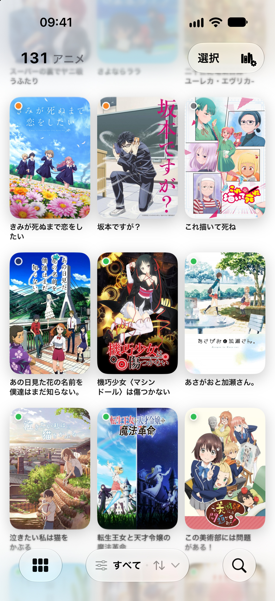
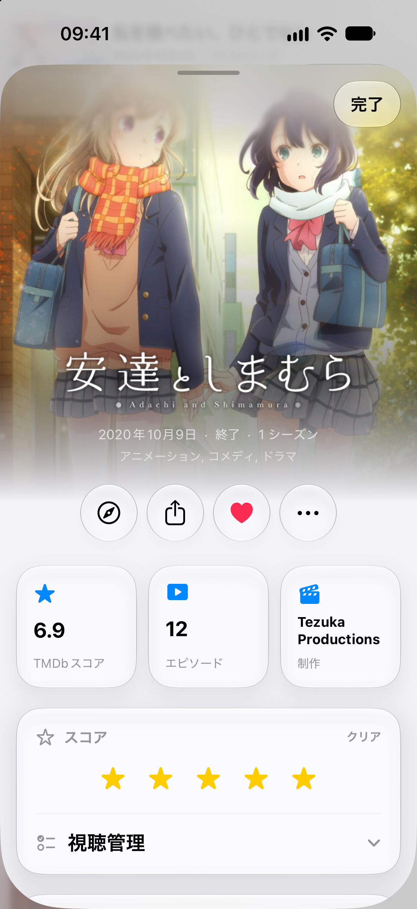
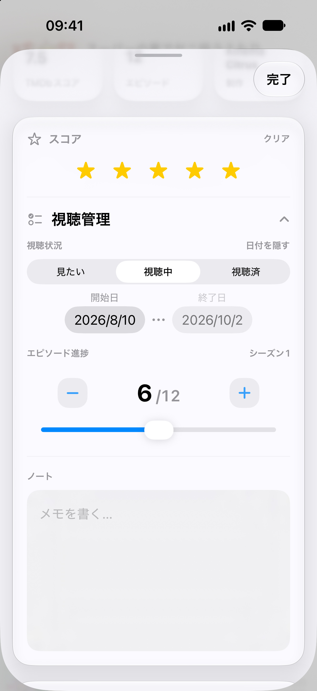
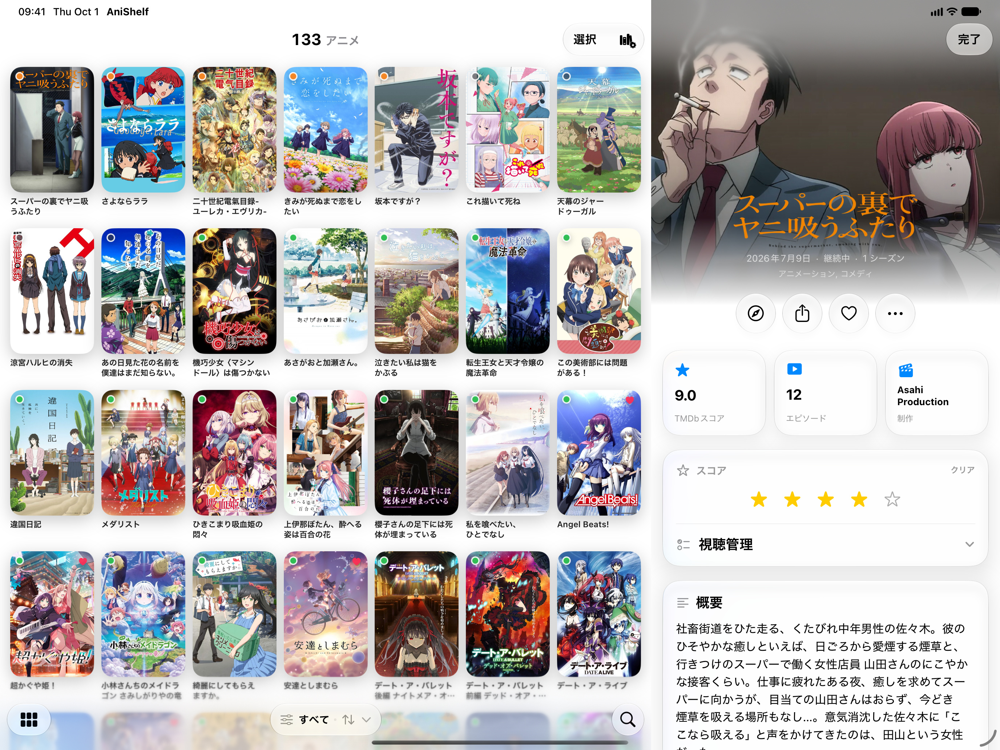
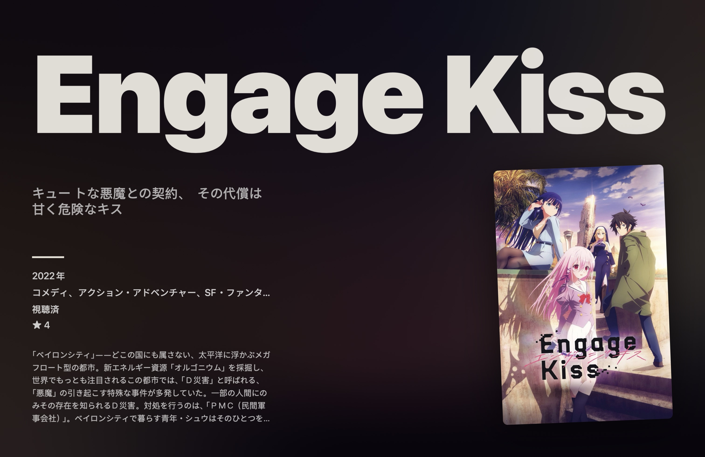

<div align="center">
  

  <h1>AniShelf</h1>

  <p>A native app for tracking and managing your anime library on iPhone, iPad, and Mac.</p>

  <p>
    
    
    <a href="https://apps.apple.com/app/id6759359144"></a>
  </p>

  <p><a href="README.zh-CN.md">中文</a> · <a href="https://anishelf.konakona.dev">Website</a> · <a href="docs/anishelf_overview.en.md">User Guide</a> · <a href="docs/screenshots.md">Screenshots</a> · <a href="https://testflight.apple.com/join/ns3sR38X">TestFlight Beta</a></p>
</div>

---

## Features

### 📚 Browse and track

- **Three views:** switch between a poster grid, a featured card, and a detailed list.
- **Categories:** organize anime into custom categories, describe them in natural language, and find matches automatically.
- **Track Progress:** track watch status, scores, episode-level progress, and rewatches.
- **Episode Notes:** write a note for each episode, alongside an overall note for the series or season.
- **Broadcast & Reminders:** view broadcast airtimes for eligible anime and set reminders for each new episode, before or after airtime.
- **Open In:** jump from an entry to Infuse, Kazumi, or bilibili.

<p align="center">
  
  
  
</p>

### 🖥️ iPad and Mac

A sidebar holds your categories, and the entry you pick opens in an inspector beside the library. Open more windows, each with its own category, filters, sorting, and view mode.

<p align="center">
  
</p>

### 🌌 Mac screen saver

Show your library's posters and artwork as a macOS screen saver. Choose which entries appear, pick a layout and the details on each slide, and install it from Settings. It updates as your library changes.

<p align="center">
  
</p>

### ☁️ Sync, backup, and the terminal

- **iCloud Sync** keeps your library and preferences the same on every device.
- **Backup and export.** Back up and restore your library and settings, or export it as CSV, JSON, a spreadsheet, and more.
- **Metadata in English, Chinese, or Japanese**, searched and fetched from TMDb.
- **[anishelf-cli](https://github.com/samuelhe52/anishelf-cli)** gives you, or your coding agent, read-only access to your library with the `ani` command. Agents can follow its [SKILL.md](https://github.com/samuelhe52/anishelf-cli/blob/main/skills/anishelf-cli/SKILL.md).

**More screenshots, including dark mode, iPhone Duo, Mac, and every screen saver layout: [Screenshots](docs/screenshots.md).**

## Get AniShelf

Download it from the [App Store](https://apps.apple.com/app/id6759359144) for iPhone, iPad, and Mac (iOS, iPadOS, and macOS 26 or later), or join the [TestFlight Beta](https://testflight.apple.com/join/ns3sR38X) to try new features first.

> AniShelf needs a free TMDb API key, which you can get from [The Movie Database](https://www.themoviedb.org/settings/api).

## Development

Requires Xcode 27 and Swift 6.

```bash
git clone https://github.com/samuelhe52/AniShelf.git
cd AniShelf
open MyAnimeList.xcodeproj   # then ⌘R; the app asks for your TMDb API key on first launch
```

`make help` lists the build, run, and test targets. The Xcode project and internal directories still use the app's former name, **MyAnimeList**.

Pull requests are welcome. Commit messages follow [Conventional Commits](https://www.conventionalcommits.org/) with an imperative, capitalized subject, for example `feat: Add library search`.

## License

Apache License 2.0. See [LICENSE](LICENSE).

## Acknowledgments

- [The Movie Database (TMDb)](https://www.themoviedb.org/) for its comprehensive anime database
- [Kingfisher](https://github.com/onevcat/Kingfisher) for image loading and caching
