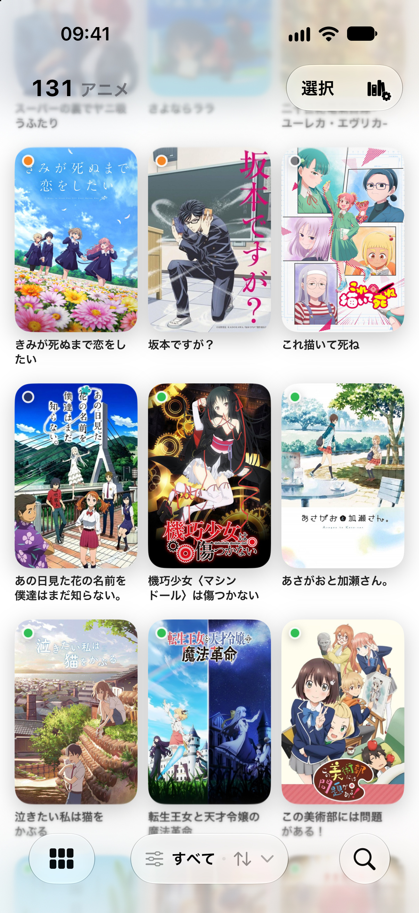
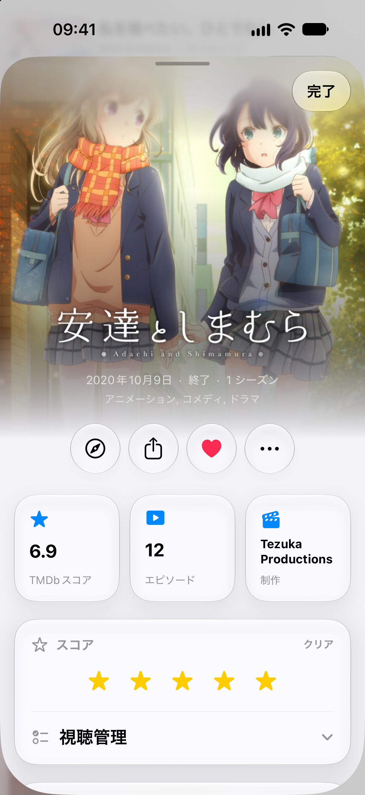
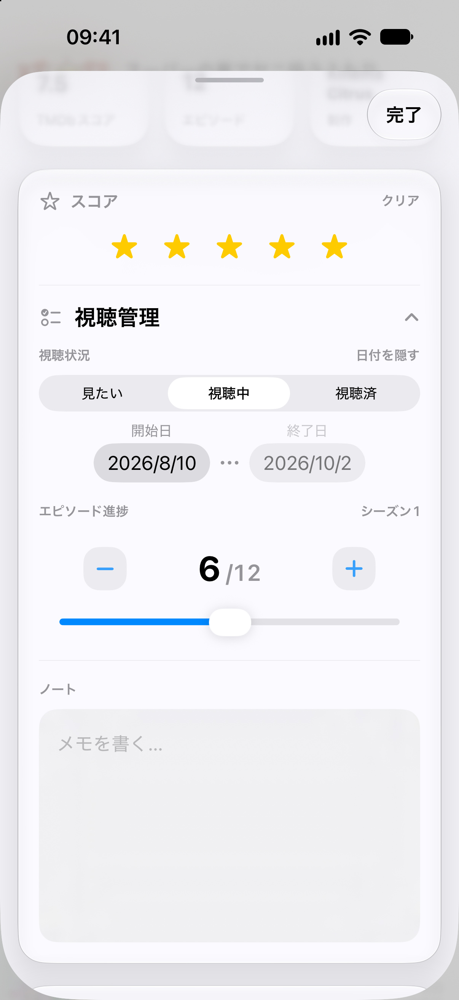
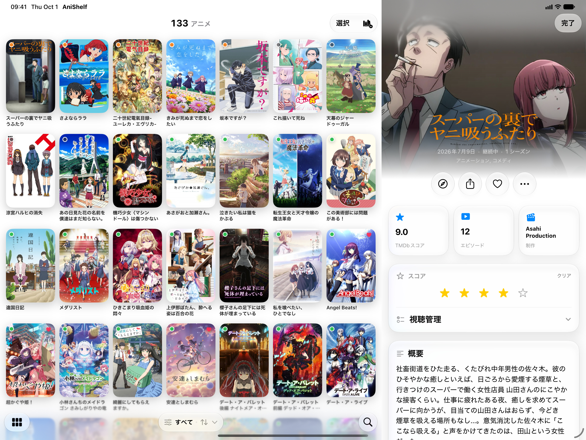

<div align="center">
  

  <h1>AniShelf</h1>

  <p>一款适用于 iPhone、iPad 和 Mac 的原生动漫收藏管理应用。</p>

  <p>
    
    
    <a href="https://apps.apple.com/app/id6759359144"></a>
  </p>

  <p><a href="README.md">English</a> · <a href="https://anishelf.konakona.dev/zh/">官方网站</a> · <a href="docs/anishelf_overview.md">使用教程</a> · <a href="docs/screenshots.zh-CN.md">截图</a> · <a href="https://testflight.apple.com/join/ns3sR38X">TestFlight 测试版</a></p>
</div>

---

## 功能

### 📚 浏览与追踪

- **三种视图**：海报网格、精选卡片、详细列表，任你切换。
- **分类**：自定义分类整理番剧，用自然语言描述，自动筛选匹配作品。
- **进度追踪**：标记观看状态、打分，精准记录单集观看进度和重看次数。
- **分集笔记**：为每一集单独记录笔记，也可以为系列或单季写整体笔记。
- **播出与提醒**：查看符合条件番剧的播出时间，并为新番每集设置播出前或播出后的提醒。
- **打开方式**：从条目直接跳转到 Infuse、Kazumi 或哔哩哔哩。

<p align="center">
  
  
  
</p>

### 🖥️ iPad 与 Mac

分类位于侧边栏，选中的条目在资料库旁的检查器中打开。可以打开多个窗口，每个窗口分别记住自己的分类、筛选、排序和视图模式。

<p align="center">
  
</p>

### 🌌 Mac 屏保

把资料库的海报和背景图变成 macOS 屏幕保护程序。选择要展示的作品、布局以及每张幻灯片显示的信息，在设置中即可安装。资料库变化时，屏保会自动更新。

<p align="center">
  
</p>

### ☁️ 同步、备份与终端

- **iCloud 同步**：在所有设备间同步资料库和偏好设置。
- **备份与导出**：备份和还原资料库与设置，或导出为 CSV、JSON、电子表格等格式。
- **中文、英文、日文元数据**：通过 TMDb 检索和获取。
- **[anishelf-cli](https://github.com/samuelhe52/anishelf-cli)**：提供 `ani` 命令，让你或你的编程 Agent 以只读方式访问资料库。Agent 可以按照它的 [SKILL.md](https://github.com/samuelhe52/anishelf-cli/blob/main/skills/anishelf-cli/SKILL.md) 操作。

**更多截图（包括深色模式、iPhone Duo、Mac 和全部屏保布局）请见[截图](docs/screenshots.zh-CN.md)。**

## 获取 AniShelf

从 [App Store](https://apps.apple.com/app/id6759359144) 下载，支持 iPhone、iPad 和 Mac（iOS、iPadOS 和 macOS 26 及以上版本）；也可以加入 [TestFlight 测试版](https://testflight.apple.com/join/ns3sR38X)，抢先体验新功能。

> 使用 AniShelf 需要一个 TMDb API 密钥，可以从 [The Movie Database](https://www.themoviedb.org/settings/api) 免费获取。

## 开发

需要 Xcode 27 和 Swift 6。

```bash
git clone https://github.com/samuelhe52/AniShelf.git
cd AniShelf
open MyAnimeList.xcodeproj   # 然后按 ⌘R；首次启动时应用会提示输入 TMDb API 密钥
```

`make help` 会列出构建、运行和测试命令。Xcode 项目和内部目录仍沿用应用的旧名 **MyAnimeList**。

欢迎提交 Pull Request。Commit message 遵循 [Conventional Commits](https://www.conventionalcommits.org/)，主题使用祈使语气并首字母大写，例如 `feat: Add library search`。

## 许可证

Apache License 2.0，详见 [LICENSE](LICENSE)。

## 致谢

- 感谢 [The Movie Database (TMDb)](https://www.themoviedb.org/) 提供全面的动画数据库
- 感谢 [Kingfisher](https://github.com/onevcat/Kingfisher) 提供图片加载与缓存功能
